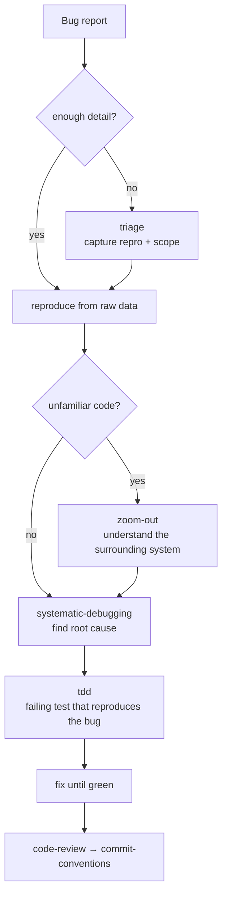

# Bug fix

Work from raw data, not theories. Reproduce before you fix; lock it with a test.

## The path

| Step | Skill | What you get |
|------|-------|--------------|
| 1. Scope | `triage` | A clear, reproducible report (if the bug isn't filed yet) |
| 2. Context | `zoom-out` | The bigger picture, if the code is unfamiliar |
| 3. Diagnose | `systematic-debugging` | The actual root cause, traced from real data |
| 4. Lock | `tdd` | A failing test that reproduces the bug first |
| 5. Fix | — | Make the test green; don't over-reach |
| 6. Review | `code-review` | House gates, then `commit-conventions` |

## Gates

- No fix without a reproduction. If there's no error output, get it first.
- Write the regression test *before* the fix — it must fail, then pass.
- Two failed attempts → stop, re-read the section top-down, say where the mental
  model was wrong.
