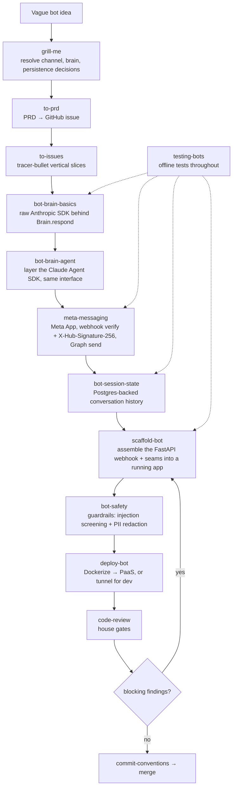

# Build a chatbot

The full path for a Claude-powered WhatsApp/Instagram bot. It's the standard
spec-driven pipeline (`feature-dev`) with the `chatbot-toolkit` skills slotted in
for the domain work. The bundled reference app at
`plugins/chatbot-toolkit/reference-app/` is the single source of truth — every
skill below adapts from it rather than reinventing.

## The path

| Step | Skill | What you get |
|------|-------|--------------|
| 1. Interview | `grill-me` | Channel, brain, and persistence decisions resolved — no code yet |
| 2. Spec | `to-prd` | A PRD as the contract, in the working repo's issues |
| 3. Slice | `to-issues` | Independently-grabbable tracer-bullet tickets |
| 4. Brain | `bot-brain-basics` | A `Brain.respond()` on the raw Anthropic Messages API |
| 5. Agent | `bot-brain-agent` | The Claude Agent SDK layered behind the same interface |
| 6. Channel | `meta-messaging` | Meta App setup, webhook verify + signature check, Graph send |
| 7. Sessions | `bot-session-state` | Durable per-conversation history in Postgres |
| 8. Assemble | `scaffold-bot` | The FastAPI webhook gluing the seams into a running app |
| 9. Safety | `bot-safety` | Prompt-injection screening + PII redaction |
| 10. Ship | `deploy-bot` | A public HTTPS webhook Meta accepts (PaaS or dev tunnel) |
| —. Test | `testing-bots` | Offline tests at every step (fixtures, mocked Graph + Anthropic) |
| —. Review | `code-review` | House quality gates before merge |
| —. Commit | `commit-conventions` | Clean history |

`testing-bots` isn't a phase — it runs *throughout*: every brain, channel, session,
and webhook change lands with an offline test (captured webhook fixtures, mocked
Graph and Anthropic) before review.

## Gates

- Plan and build are separate — accept the spec before any code.
- The brain interface is fixed early (`Brain.respond()`); `bot-brain-agent` swaps
  the implementation without changing callers.
- Forced verification — the reference-app test suite green *with evidence* before
  "done". Verify the deploy with the webhook handshake before pointing Meta at it.
- Loop review → assemble until `code-review` has no blocking findings.
