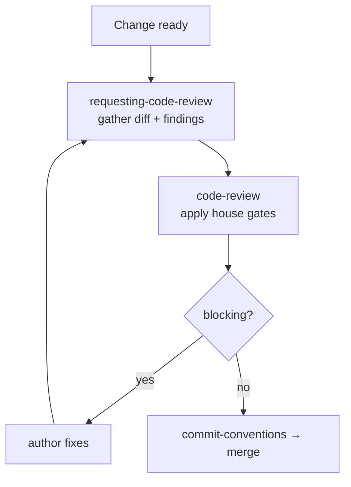

# Code review

The org review path. `code-review` is the standard; `requesting-code-review`
(superpowers) is the mechanic that gathers the diff.

## House gates (block on these)

1. **Correctness** — bugs, edge cases, unhandled real-contract errors.
2. **Verification** — green type-check/lint/tests *with evidence*, not "should work".
3. **Structural integrity** — no duplicated state, one source of truth, fix flawed
   architecture rather than patch it.
4. **Simplicity** — fewer lines if equally clear; no speculative generality.
5. **Dead code** — no unused imports/exports/debug logs.
6. **Security** — secrets, injection, authz gaps.
7. **Tests** — test the code, not themselves; integration over unit where it fits.

Verdict is explicit: approve / approve-with-nits / request-changes. Never
approve with blocking items open.
