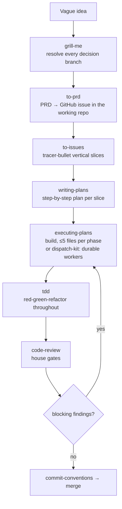

# Feature development

The full spec-driven path. Use it for anything 3+ steps or with an
architectural decision. Trivial single-file changes skip to TDD + review.

> **Building UI?** The optional `frontend-toolkit` skills (`component-design`,
> `state-management`, `styling-systems`, `data-fetching`, `forms-and-validation`,
> `accessibility-audit`, `frontend-performance`, `frontend-testing`, and the
> React Native trio) slot into steps 5–7 — reach for them by concern during build
> and review.

## The path

| Step | Skill | What you get |
|------|-------|--------------|
| 1. Interview | `grill-me` | Shared understanding; no code yet |
| 2. Spec | `to-prd` | A PRD as the contract, in the working repo's issues |
| 3. Slice | `to-issues` | Independently-grabbable tickets |
| 4. Plan | `writing-plans` | A reviewable plan per slice |
| 5. Build | `executing-plans` (inline) or `dispatch-kit` (durable workers) | Implementation, phased — inline, or one autonomous worker per slice |
| 6. Discipline | `tdd` | Tests drive the code |
| 7. Review | `code-review` | House quality gates before merge |
| 8. Commit | `commit-conventions` | Clean history |

`sdd-kit` orchestrates steps 1–7 with the house gates. Start there:
`/hq-core:sdd-kit`.

## Gates

- Plan and build are separate — accept the spec before any code.
- Forced verification — type-check, lint, tests green *with evidence* before "done".
- Loop step 6→5 until review has no blocking findings.
