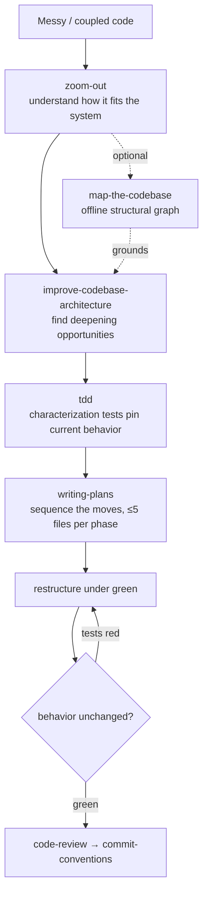

# Refactor

Change structure, not behavior. Characterize current behavior with tests first,
then restructure under green.

## The path

| Step | Skill | What you get |
|------|-------|--------------|
| 1. Context | `zoom-out` | How the code fits the larger system |
| 1.5. Map *(optional)* | `map-the-codebase` | An offline structural graph that grounds the next step in real call/import structure (needs `codebase-toolkit`) |
| 2. Find | `improve-codebase-architecture` | Concrete deepening / consolidation opportunities (needs `codebase-toolkit`) |
| 3. Pin | `tdd` | Characterization tests that lock current behavior |
| 4. Plan | `writing-plans` | A phased sequence of safe moves |
| 5. Move | — | Restructure; keep tests green every step |
| 6. Review | `code-review` | House gates, then `commit-conventions` |

## Gates

- **Delete before you build** — remove dead code, unused exports/imports, debug
  logs first, as a separate commit.
- Behavior must not change — tests green before and after every move.
- Phases touch ≤5 files; verify between phases.
- `improve-codebase-architecture` lives in `codebase-toolkit` — recommend-workflow
  offers to install it.
